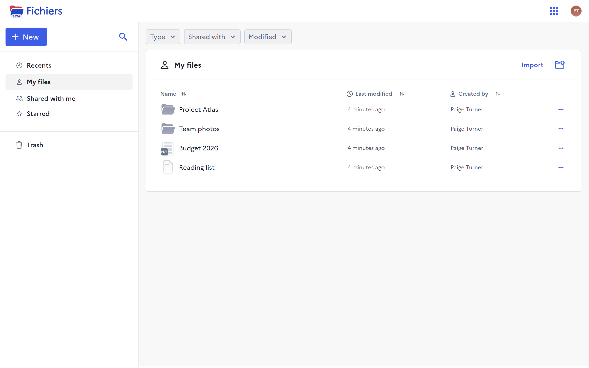

# La Suite Drive

**Open source file storage and sharing, self-hostable under MIT.**

Drive stores your files in the browser, opens them in place, and shares them
with exactly the people you choose. [DINUM](https://www.numerique.gouv.fr/),
the French government's digital agency, develops it as part of
[La Suite](https://lasuite.numerique.gouv.fr/), and runs it for French public
servants at [fichiers.numerique.gouv.fr](https://fichiers.numerique.gouv.fr/).

<figure markdown="span">
  
  <figcaption>My files, with the sidebar on the left and the filters above the list</figcaption>
</figure>

## Features

- **Upload files and whole folders**, by dragging them in or from the Import
  button
- **Preview PDFs, images, audio and video** without downloading them
- **Edit office documents online** through Collabora or OnlyOffice
- **Share a file or a folder** with people, each with their own role, and with
  a link anyone, any signed-in user or only those people can open
- **Invite people by email** before they have an account
- **Trash** that keeps deleted items until you restore them or delete them for
  good
- **Malware scanning** of every uploaded file, once a scanner is connected
- **Full-text search** through [Find](https://github.com/suitenumerique/find),
  the search service of La Suite
- **Storage quotas** per user
- **Sign-in through any [OpenID Connect](https://openid.net/developers/how-connect-works/) provider**

## Where to start

-   **People using Drive**

    ---

    - [Get started](user/getting-started.md)
    - [Share a file or a folder](user/sharing.md)
    - [Find, move and restore files](user/organising.md)

-   **System administrators**

    ---

    - [Install it](self-hosting/index.md)
    - [Turn on online editing](self-hosting/configuration/online-editing.md)
    - [Look up a setting](reference/env-variables.md)
    - [Monitor it](self-hosting/configuration/monitoring.md)

-   **Developers and integrators**

    ---

    - [How Drive works](overview/how-drive-works.md)
    - [Call Drive from another application](integrating/external-api.md)
    - [Browse the API routes](reference/swagger.html)
    - [Read storage usage per user](integrating/usage-metrics.md)
    - [Change the code](contributing/develop.md)

## Known public instances

| Address | Operator | Who can sign in |
| --- | --- | --- |
| [fichiers.numerique.gouv.fr](https://fichiers.numerique.gouv.fr/) | DINUM | French central administration, through [ProConnect](https://www.proconnect.gouv.fr/) |
| [fichiers.suite.anct.gouv.fr](https://fichiers.suite.anct.gouv.fr/) | ANCT | French local administration, through ProConnect |
| [fichiers.lasuite.coop](https://fichiers.lasuite.coop/) | lasuite.coop | Anyone, as a demo: files and accounts are reset after a month |
| [mosa.cloud](https://mosa.cloud/) | mosa.cloud | A Dutch company offering La Suite apps |

## Community and support

- **Matrix**: [#drive-official:matrix.org](https://matrix.to/#/#drive-official:matrix.org)
- **Issues**: [github.com/suitenumerique/drive/issues](https://github.com/suitenumerique/drive/issues)
- **Translations**: [Crowdin](https://crowdin.com/project/lasuite-drive)
- **Roadmap**: [the public roadmap](https://docs.numerique.gouv.fr/docs/eacaabdb-d92b-465d-bedf-75d28b397221/)

## Reporting a vulnerability

Report it privately, through the
[vulnerability report form](https://vdp.numerique.gouv.fr/p/Send-a-report?lang=en)
or to `drive@numerique.gouv.fr`, never in a public issue or pull request. The
maintainers fix it first, then name it in the release notes. The full policy is
[`SECURITY.md`](https://github.com/suitenumerique/drive/blob/main/SECURITY.md).

## License

The code is released under the
[MIT License](https://github.com/suitenumerique/drive/blob/main/LICENSE).
