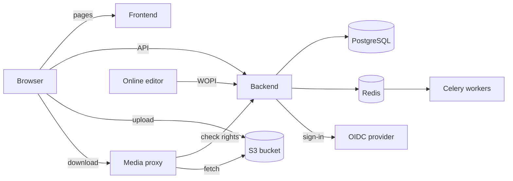

# How Drive works

For developers, integrators and administrators who want to know what happens
behind the file list: the pieces Drive is made of, and how a file travels
through them.

## Key concepts

- **Item**: a file or a folder. Items form one tree per top-level folder, stored
  in PostgreSQL as a path, which is how Drive finds everything under a folder
  in one query.
- **Access**: a user's role on an item, **Reader**, **Editor**,
  **Administrator** or **Owner**. A role on a folder applies to everything
  under it, except a restricted folder: only the people given a role on that
  folder itself get in.
- **Link reach**: who an item's link lets in, **Private**, **Connected** for
  any signed-in user, or **Public** for anyone.
- **Upload state**: where a file is in its life: being uploaded, being copied,
  being converted, being scanned for malware, too large to scan, ready, or
  flagged suspicious.

## What are the pieces?

| Piece | What it does |
| --- | --- |
| Frontend | A Next.js app built into static files, served by nginx |
| Backend | A Django REST API, run by gunicorn |
| Celery workers and beat | Background tasks, and the ones that run on a schedule |
| PostgreSQL | Items, accesses, users, invitations: everything but the files' content |
| Redis | Sessions, the cache, and the background tasks' queue |
| S3 bucket | The files' content |
| Media proxy | nginx, or ingress-nginx on Kubernetes, in front of the bucket for downloads |
| OIDC provider | Signs users in |

## How does an upload work?

The file never passes through the backend:

1. The browser asks the backend to create the file, with its name and size.
   The backend refuses an extension the settings forbid and checks the user
   may upload. It then creates the item and answers with an upload address
   for the bucket, signed for that exact size and valid one minute by
   default.
2. The browser sends the file straight to the bucket at that address.
3. The browser tells the backend the upload ended. The backend checks the size,
   reads the file's type from its first bytes, refuses a type the settings
   forbid, then hands the file to the malware scanner.

So the bucket must be reachable from browsers, with a CORS rule allowing
Drive's domain.

## How does a download work?

Every file opened or downloaded from the file list goes through the media
proxy, so the bucket itself can stay private. A folder downloaded as a ZIP and
a file opened in the online editor go through the backend instead:

1. The file's address is Drive's own, under `/media/`.
2. For each request, the proxy asks the backend's `media-auth` route whether
   this user may read this file.
3. If so, the backend answers with signed headers for the bucket, and the proxy
   fetches the file with them.

Rights are checked at every request, so removing someone's access takes effect
at once, and a copied file address is useless to anyone without the rights.

## How are rights computed?

A user's role on an item is the highest of:

- the roles given to them, or to a team they belong to, on the item and on
  every folder above it;
- the role of the item's link, or of a folder above it, if its reach lets the
  user in and it has not expired. A link gives **Reader** or **Editor**,
  never more.

So a role given on a folder can be raised on an item inside it, never lowered.
The one exception is a restricted folder, which drops the roles of the folders
above it.
What each role allows is in [Sharing](../user/sharing.md#roles).

## What happens when a file is deleted?

Deleting moves the item and everything under it to the trash: nobody can open
them, and their owner can restore them for 30 days, the
[`TRASHBIN_CUTOFF_DAYS`](../reference/env-variables.md#TRASHBIN_CUTOFF_DAYS)
setting. A restricted folder inside goes to the trash only if the person
deleting owns it; otherwise it stays with its owners.

After those 30 days, plus 7 more of
[`PURGE_GRACE_DAYS`](../reference/env-variables.md#PURGE_GRACE_DAYS), the
`purge_deleted_items` command hands the items to the Celery workers, which
erase them from the bucket and the database. The Helm chart runs it every
night. An item deleted for good from the trash is erased at once.

## What runs in the background?

Celery workers run the work a request should not wait for:

- the malware scan of each upload;
- sending files to the [search service](../self-hosting/configuration/search.md);
- duplicating a file and converting an old office file;
- renaming a file in the bucket after its name changes;
- erasing purged items from the bucket and the database;
- importing a CSV of accounts to merge;
- reading the online editors' file types, every day.

The clean-up commands, removing unfinished uploads and purging the trash, run
as cron jobs on Kubernetes, beside two that catch stuck malware scans.
Elsewhere they run through Celery beat when their `_SCHEDULE` setting is set,
and nothing cleans up without it.

## How does online editing work?

The online editor keeps no files of its own: it opens and saves them through
Drive's WOPI routes, `/api/v1.0/wopi/`, with a token the backend gives the
browser for that file and that user. The editor locks the file while it is
open, Drive keeps that lock 30 minutes unless the editor renews it, and Drive
refuses a save that does not carry the lock, so two editors never overwrite
each other.
[Online editing](../self-hosting/configuration/online-editing.md) sets it up.
