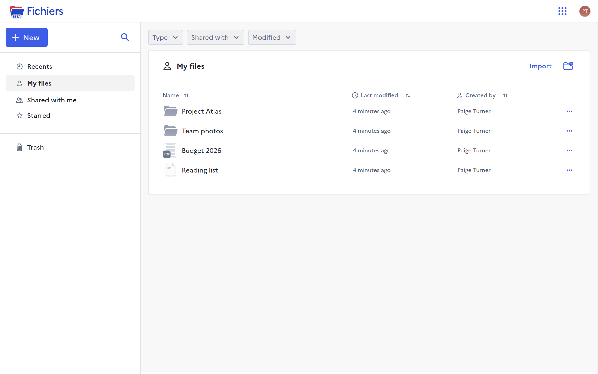
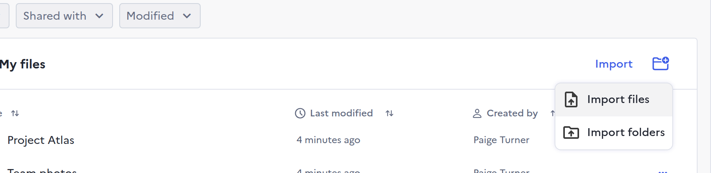
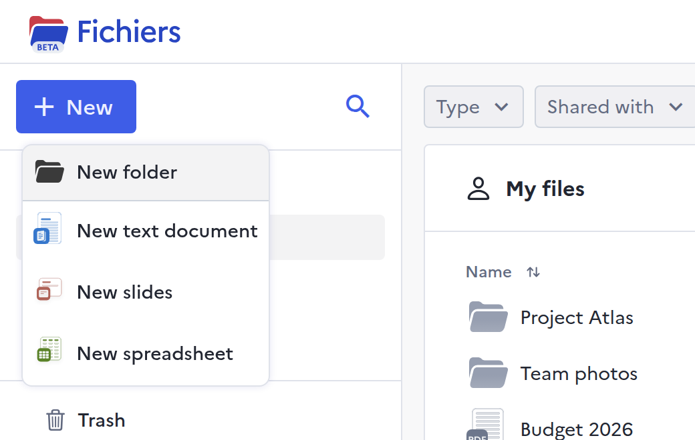
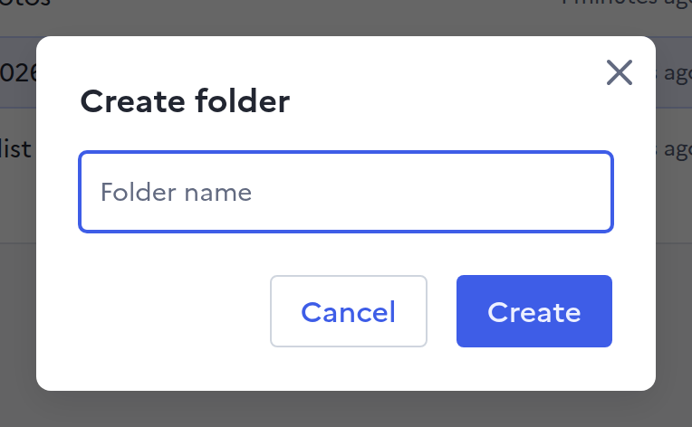
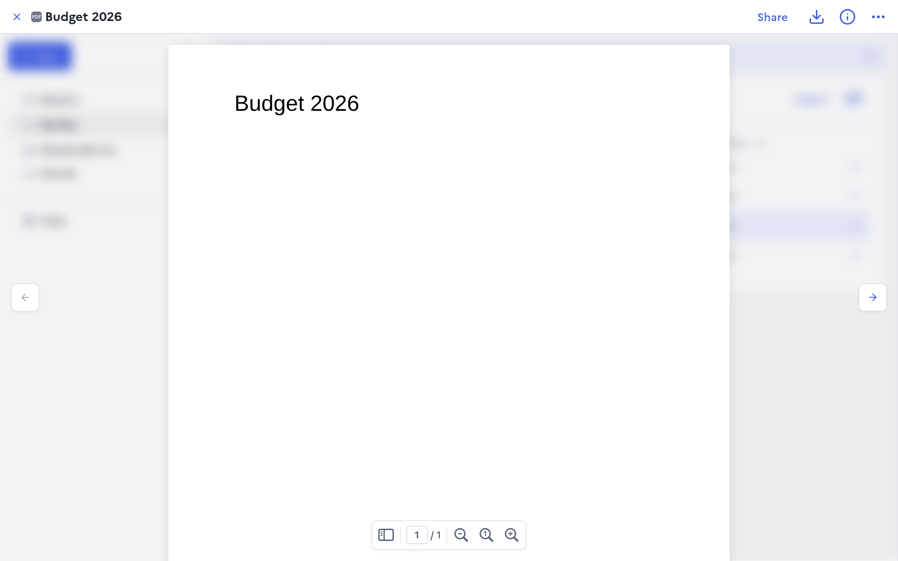
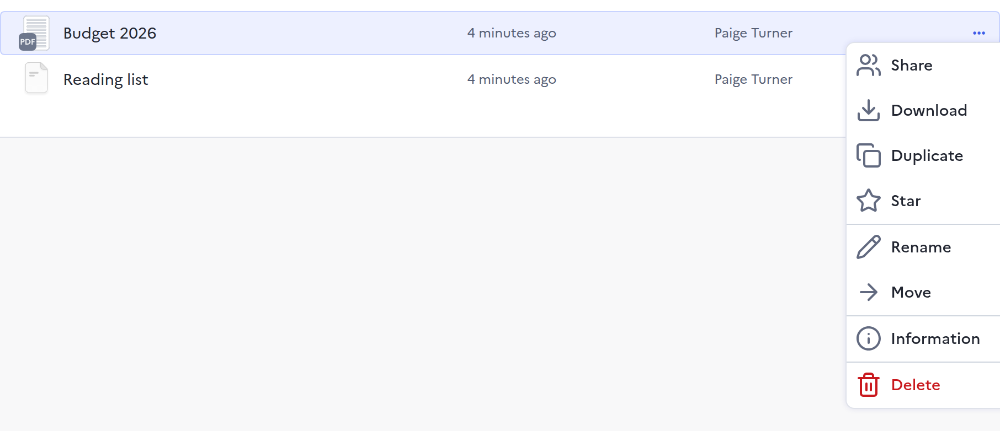

# Getting started

For anyone who stores files in Drive from a web browser. Drive needs nothing
installed: sign in on your organisation's Drive address and your files are
there.

## Sign in

Open your organisation's Drive address and click **Sign in**. Drive sends you
to your organisation's sign-in page, then brings you back to the page you first
opened, or to **My files**.

## Find your way around

<figure markdown="span">
  
  <figcaption>My files: the sidebar on the left, your files and folders on the right</figcaption>
</figure>

The sidebar holds five places:

- **Recents**: every file you can open, the most recently changed first.
- **My files**: the files and folders you created.
- **Shared with me**: the files and folders other people created and shared
  with you.
- **Starred**: the files and folders you starred, to reach them in one click.
- **Trash**: the deleted items you own, until you restore them or they are
  deleted for good.

Above the list, the **Type**, **Shared with** and **Modified** filters narrow
it down. Click a column title to sort by it.

## Add files

<figure markdown="span">
  
  <figcaption>Import, at the top right of the list: Import files or Import folders</figcaption>
</figure>

Click **Import**, then **Import files** or **Import folders**, and pick them on
your computer. Dragging files or folders from your computer onto the list does
the same. A box at the bottom of the screen shows each file's progress, and a
file can be cancelled there while it uploads.

Your administrator sets the largest file Drive accepts, 2 GB unless they
changed it, and which file types it accepts: by default, only those on a list
they can change. Drive names the file and the reason when it refuses one.

## Create a folder or a document

<figure markdown="span">
  
  <figcaption>New: a folder, a text document, slides or a spreadsheet</figcaption>
</figure>
<figure markdown="span">
  
  <figcaption>New → New folder: type its name, then Create</figcaption>
</figure>

Click **New**, then **New folder**, type its name and click **Create**. The
folder is created where you are, or in **My files** when you cannot add to the
open folder.

**New text document**, **New slides** and **New spreadsheet** ask for a name,
then create an empty document in the open formats `.odt`, `.odp` and `.ods`.
Double-click it to open it in the online editor, when your administrator has
set one up.

## Open a file

Double-click a file to open it. PDFs, images, audio and video play in Drive
itself, and the arrows on each side move to the previous or next file in the
folder.

<figure markdown="span">
  
  <figcaption>The viewer: Share, Download and Information at the top right</figcaption>
</figure>

A text document, a spreadsheet or a presentation opens in the online editor in
a new tab, when your administrator has set one up. When you can edit an old
Microsoft Office file, `.doc`, `.xls` or `.ppt`, and your administrator has set
up conversion, Drive first asks you to convert it: it keeps the original and
adds a converted copy beside it, or in **My files** when you cannot add to that
folder.

## Act on a file or a folder

<figure markdown="span">
  
  <figcaption>Right-click a row, or click its … button</figcaption>
</figure>

Right-click a file or a folder, or click the **…** at the end of its row, for
everything you can do with it:

- **Share** it, as [Sharing](sharing.md) explains.
- **Download** it. A folder downloads as a `.zip` of its files.
- **Duplicate** a file, which puts a copy beside it, or in **My files** when
  you can only read that folder.
- **Star** it, so it appears under **Starred**.
- **Rename** or **Move** it.
- **Information** opens a panel with its type, size, dates and who created it.
- **Delete** it, which moves it to the trash.

An entry you have no right to use does not appear. What each role allows is in
[Sharing](sharing.md#roles).

## Next steps

- [Share a file or a folder](sharing.md) with people or with a link.
- [Find, move and restore files](organising.md).

## What Drive cannot do

- No earlier versions of a file to go back to.
- No app to sync a folder of your computer: every file goes through the
  browser.
- No download of several selected items at once: download them one by one, or
  put them in a folder and download the folder.
