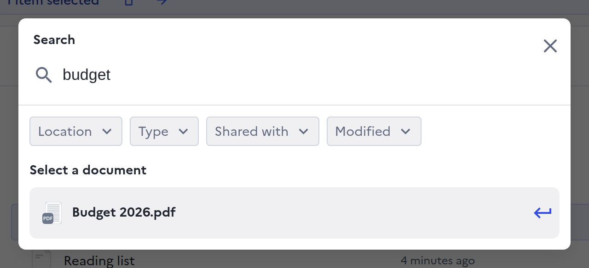
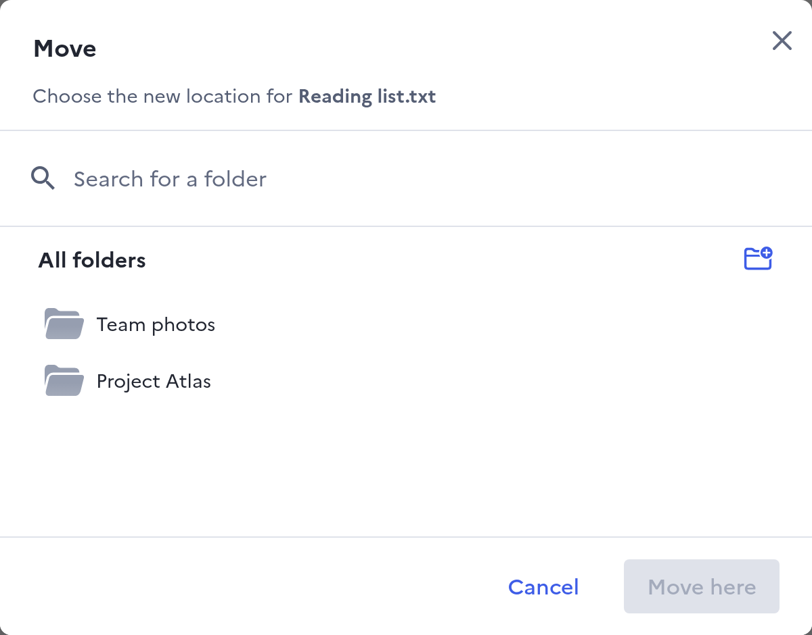
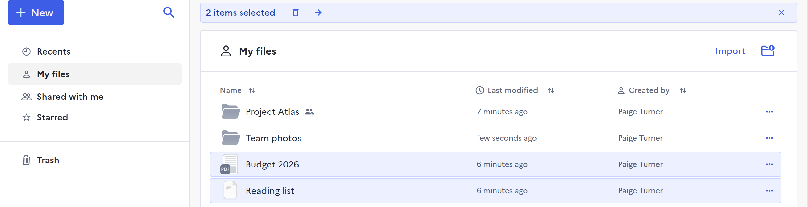
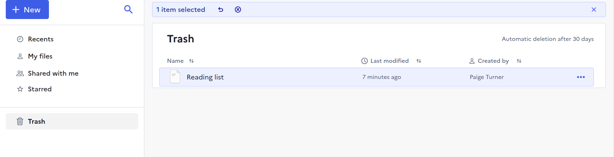

# Finding and organising files

For anyone with more than a handful of files: how to find one, move it, and
get it back from the trash.

## Search

Click the magnifying glass at the top of the sidebar, or press ++ctrl+k++, or
++cmd+k++ on a Mac, and type a word of the file's name.

<figure markdown="span">
  
  <figcaption>Search: type a word, narrow it with Location, Type, Shared with or Modified</figcaption>
</figure>

The **Location**, **Type**, **Shared with** and **Modified** filters narrow the
results. Press ++enter++ or click a result to open it.

Drive searches the names of your files and folders. When your administrator
has connected the [Find](https://github.com/suitenumerique/find) search
service, it also searches the text inside them.

## Star what you use often

Right-click a file or a folder and pick **Star**: it then appears under
**Starred** in the sidebar. **Unstar** takes it off the list and leaves the item
where it is.

## Move files and folders

Right-click an item and pick **Move**, choose the destination folder, then
click **Move here**.

<figure markdown="span">
  
  <figcaption>Move: pick a folder, then Move here</figcaption>
</figure>

Dragging items onto a folder, in the list or in the sidebar, moves them too.
A moved item takes the sharing of its new folder, so Drive asks before a move
that changes who can open it.

Only an item's owners and administrators can move it.

## Select several items

<figure markdown="span">
  
  <figcaption>The selection bar: delete, move, or clear the selection</figcaption>
</figure>

Click an item to select it. ++ctrl++-click, or ++cmd++-click on a Mac, adds or
removes one more, and ++shift++-click selects everything between two items.
Dragging a box around items on empty space selects them too. The bar at the top
then deletes or moves them all at once.

In the list, the arrow keys move the selection, and ++shift++ with an arrow key
extends it.

## Delete and restore

**Delete** moves an item to the trash, and everything inside a folder goes with
it, except a restricted folder inside, which stays with its owner. Nobody you
shared it with can open it any more.

<figure markdown="span">
  
  <figcaption>Trash: select an item, then restore it or delete it forever</figcaption>
</figure>

The trash lists the deleted items you own. Select one there, then:

- **Restore** puts it back where it was, with its sharing. If the folder it
  was in is still in the trash, it goes to the top folder of that tree.
- **Delete forever** deletes it for good. Drive asks first.

An item stays in the trash 30 days, unless your administrator set another
delay. After that it leaves the trash and can no longer be restored.

## What it cannot do

- No **Empty trash** button: delete items forever by selecting them.
- No grid of thumbnails: files are always shown as a list.
