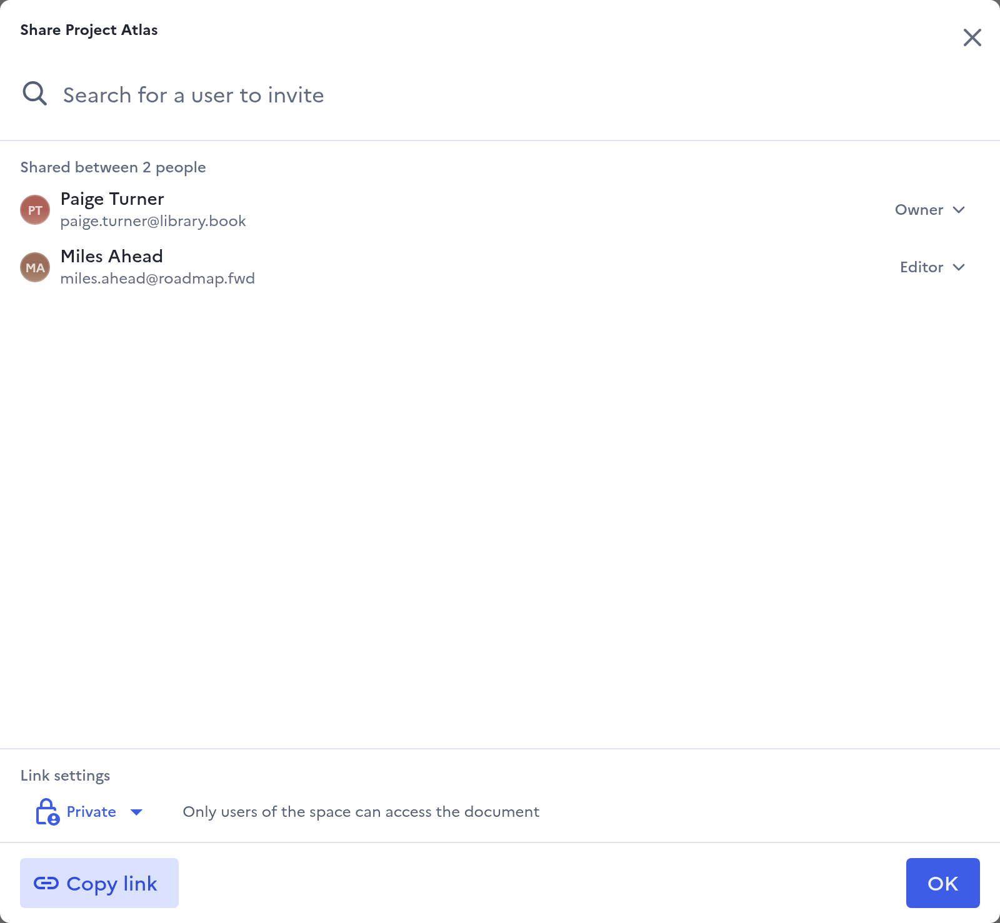
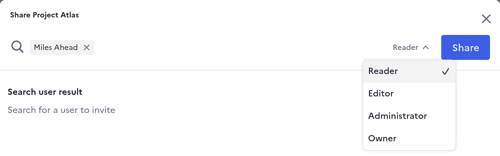
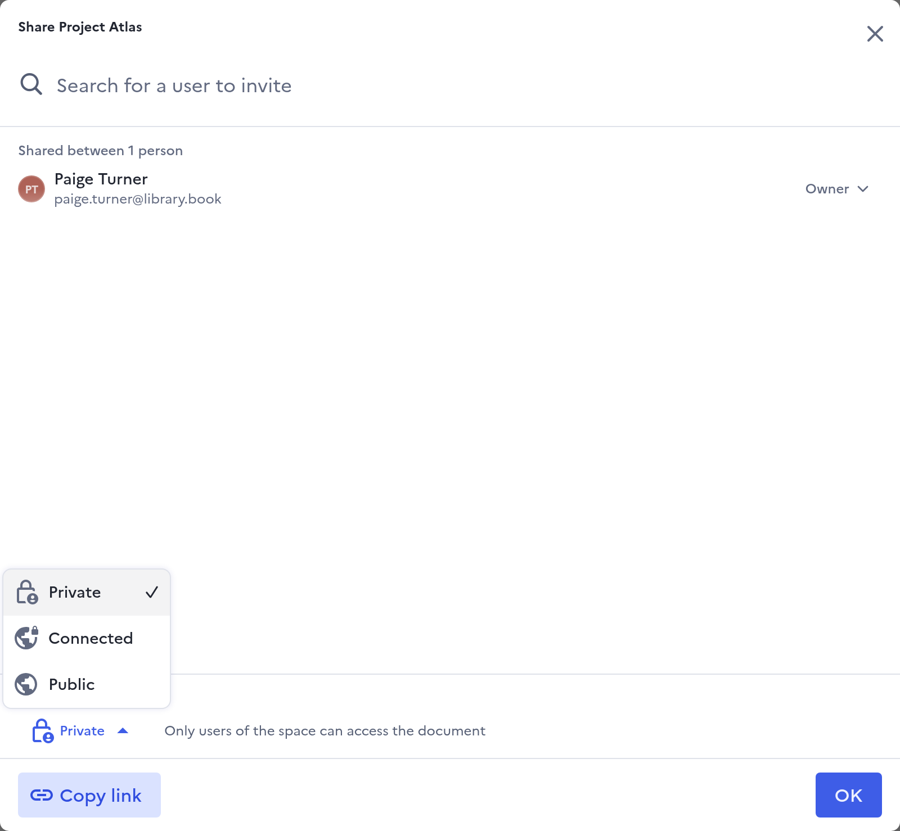
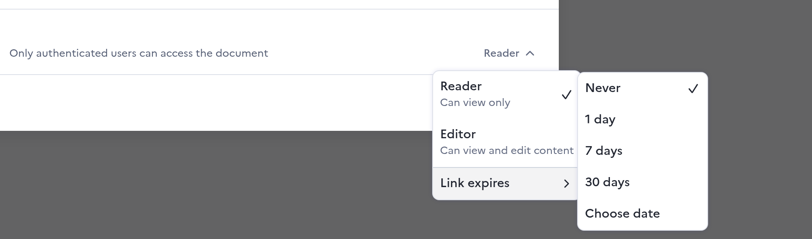

# Sharing

For anyone who wants other people to open their files. A file or a folder is
shared in two ways, and both can be used at once: with named people, each with
their own role, and with a link whose reach you choose.

Sharing a folder shares everything inside it, the files added later included.

## Open the share dialog

Right-click a file or a folder and pick **Share**. The **Share** button of the
viewer and of the Information panel open the same dialog.

<figure markdown="span">
  
  <figcaption>Share: the people with access, then the link settings at the bottom</figcaption>
</figure>

## Share with people

Type a name or an email address in **Search for a user to invite**, and pick the
person. Choose their role next to their name, **Reader** unless you change it,
then click **Share**.

<figure markdown="span">
  
  <figcaption>Pick the person, then their role, then Share</figcaption>
</figure>

Someone with no account yet gets an email inviting them. Their access starts
when they first sign in, as long as the invitation is still valid: 7 days unless
your administrator changed it.

To change someone's role, or to remove them, open the role next to their name:
**Remove access** is at the bottom of that list.

### Roles

| Role | What the dialog says | What it allows |
| --- | --- | --- |
| **Reader** | Can view only | Open and download |
| **Editor** | Can view and edit content | Also rename, add files and folders, edit documents online, and delete what they created |
| **Administrator** | Can edit and manage access | Also share, change the link settings, move, and delete anything below the top-level folder |
| **Owner** | Full control and can delete | Also make other people owners, delete a top-level file or folder, and restore from the trash |

Only an owner can make someone else an owner, and the last owner of a file or a
folder cannot be removed.

A role given on a folder applies to everything inside it. On an item inside,
it can be raised but never lowered: the dialog then reads "Inherited. To lower
role or remove access, edit the parent folder." and links that folder.

Where your administrator allows it, the owner of a folder can restrict it: only
the people named on that folder keep their access, and the roles given above it
stop applying there.

## Share with a link

**Copy link** copies the address of the file or the folder. Who that address
lets in is set under **Link settings**:

<figure markdown="span">
  
  <figcaption>Link settings: Private, Connected or Public</figcaption>
</figure>

| Setting | Who the link lets in |
| --- | --- |
| **Private** | Only the people listed in the dialog |
| **Connected** | Anyone signed in to your Drive |
| **Public** | Anyone with the link, signed in or not |

With **Connected** or **Public**, a second list beside the setting chooses
whether the link gives **Reader** or **Editor** rights. When the link opens
more than the folder above it does, the same list sets when it expires:

<figure markdown="span">
  
  <figcaption>The link's role, then Link expires: Never, 1 day, 7 days, 30 days or Choose date</figcaption>
</figure>

An expired link stops letting people in: the people listed keep their access,
and the link falls back to the setting of the folder above, **Private** when
there is none. Only owners and administrators can
change the link settings.

A link never lowers anyone's access: a person given **Editor** stays an editor,
whatever the link's role.

## Leave something shared with you

Right-click it and pick **Leave**. You lose the access you were given on that
item. An access you hold through a folder above it can only be left from that
folder. An owner or an administrator cannot leave: they first hand their role
to someone else.

## What sharing cannot do

- No access requests: someone without access cannot ask for it from Drive.
- No way to put a password on a link from the web interface.
